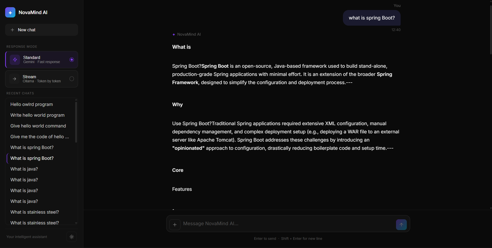
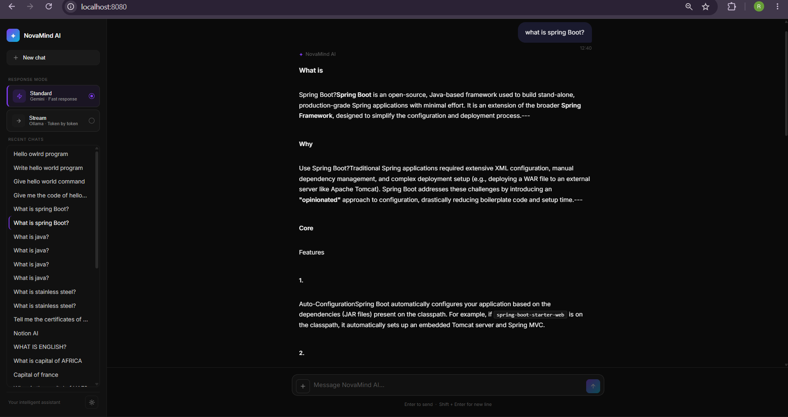

# NovaMind AI — AI Chatbot (Spring Boot)

A full-stack AI chatbot built with Java and Spring Boot.
Features multi-provider AI routing, RAG (PDF upload and Q&A),
conversation memory, Redis caching, PostgreSQL storage, and a clean chat UI.

## Screenshots

### Empty State


### Active Conversation


## Tech Stack

- Java 21
- Spring Boot 4.1.0
- Spring AI 2.0.0
- Google Gemini (gemini-3.8-flash) — primary provider for short messages
- OpenRouter (nvidia/nemotron-3.5-lightning:free) — secondary provider for long messages
- Ollama (llama3.2) — local fallback
- Ollama (nomic-embed-text) — embeddings for RAG
- Chroma — vector database for RAG
- Redis — response caching
- PostgreSQL — permanent conversation storage
- Docker — for running Chroma, Redis, and PostgreSQL

## Project Structure

src/main/java/project/chatbot/
├── ChatbotApplication.java
├── AppConfig.java
├── controller/
│ ├── Chat_Controller.java
│ ├── ChatRequest.java
│ ├── ChatResponse.java
│ └── DocumentController.java
├── service/
│ ├── ChatService.java
│ ├── ChatResult.java
│ └── RagService.java
├── entity/
│ └── ChatMessageEntity.java
├── repository/
│ ├── ChatMessageRepository.java
│ └── PostgresChatMemoryRepository.java
├── exception/
│ ├── GlobalExceptionHandler.java
│ └── ErrorResponse.java

src/main/resources/
├── application.properties ← gitignored, copy from example
├── application.properties.example
└── static/
└── index.html ← frontend chat UI


## Features

- Multi-provider routing — short messages go to Gemini, long messages go to OpenRouter
- Automatic fallback — if Gemini or OpenRouter fails, Ollama takes over
- Conversation memory — AI remembers context within a session (configurable window)
- RAG pipeline — upload a PDF and ask questions about it
- Redis caching — repeated questions are served instantly without hitting the AI (1 hour TTL)
- PostgreSQL storage — conversation history survives app restarts
- Token usage display — prompt, completion and total tokens shown below every response
- Session management — each new chat gets a unique session ID
- Light and dark theme toggle
- Global error handling with structured error responses
- GitHub Actions CI pipeline

## Prerequisites

Before running the app, make sure these are all running:

**Ollama** — in a terminal:

ollama serve
ollama pull llama3.2
ollama pull nomic-embed-text


**Chroma** — in a terminal (Docker required):

docker run -d --name chroma -p 8000:8000 chromadb/chroma


**Redis** — in a terminal (Docker required):

docker run -d --name chatbot-redis -p 6380:6379 redis:latest


**PostgreSQL** — in a terminal (Docker required):

docker run -d --name chatbot-postgres -p 5432:5432 -e POSTGRES_DB=chatbotdb -e POSTGRES_USER=chatbot -e POSTGRES_PASSWORD=chatbot123 -e TZ=UTC -e PGTZ=UTC postgres:latest


## Setup

1. Clone the repo:

git clone https://github.com/Raghav-Sharma03/AI-ChatBot-SpringBoot.git
cd AI-ChatBot-SpringBoot


2. Copy the example properties file:

cp src/main/resources/application.properties.example src/main/resources/application.properties


3. Add your API keys in `application.properties`:

spring.ai.google.genai.api-key=YOUR_GEMINI_KEY_HERE
spring.ai.openai.api-key=YOUR_OPENROUTER_KEY_HERE


- Gemini key: https://aistudio.google.com/apikey
- OpenRouter key: https://openrouter.ai (free, no credit card)

4. Run the app:

mvn spring-boot:run


5. Open http://localhost:8080 in your browser

## API Contract

### Send a message

POST /api/chat?sessionId={sessionId}
Content-Type: application/json

{
“message”: “Hello”
}


### Success Response
```json
{
  "message": "Hello! How can I help you?",
  "sessionId": "session_abc123",
  "requestTime": "2026-10-11T13:00:00",
  "responseTime": "2026-10-11T13:00:02",
  "promptTokens": 65,
  "completionTokens": 20,
  "totalTokens": 85
}
```

### Upload a PDF

POST /api/documents/upload
Content-Type: multipart/form-data

file=<your PDF file>


### Error Response
```json
{
  "status": 500,
  "error": "Something went wrong: ...",
  "path": "/api/chat",
  "timestamp": "2026-10-11T13:00:00"
}
```

## Configuration

Key properties in `application.properties`:

| Property | Description | Default |
|---|---|---|
| `chatbot.memory.max-messages` | Max messages kept in conversation memory | 10 |
| `spring.ai.model.embedding` | Which provider handles embeddings | ollama |
| `spring.ai.ollama.embedding.model` | Ollama embedding model | nomic-embed-text |
| `spring.ai.vectorstore.chroma.collection-name` | Chroma collection name | chatbot-docs |
| `spring.data.redis.host` | Redis host | localhost |
| `spring.data.redis.port` | Redis port | 6380 |
| `spring.datasource.url` | PostgreSQL connection URL | jdbc:postgresql://localhost:5432/chatbotdb |

## What I learned building this

- Spring Boot REST API design
- Spring AI integration with multiple AI providers
- Multi-provider routing and fallback chain
- Conversation memory with MessageWindowChatMemory
- RAG pipeline — PDF ingestion, vector embeddings, similarity search
- Chroma vector database integration
- Redis caching with @Cacheable and configurable TTL
- PostgreSQL integration with Spring Data JPA
- Implementing Spring AI's ChatMemoryRepository for custom storage
- Token usage tracking and display
- DTO pattern for clean request/response handling
- Global exception handling with @RestControllerAdvice
- Serving a frontend from Spring Boot static resources
- Git branching, PR workflow, and GitHub Actions CI