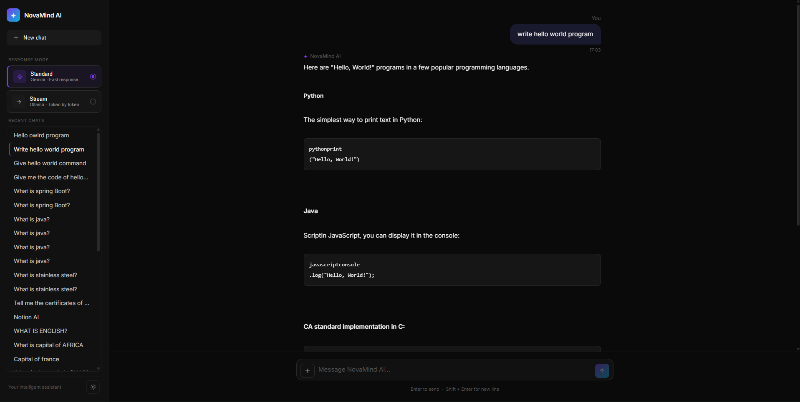
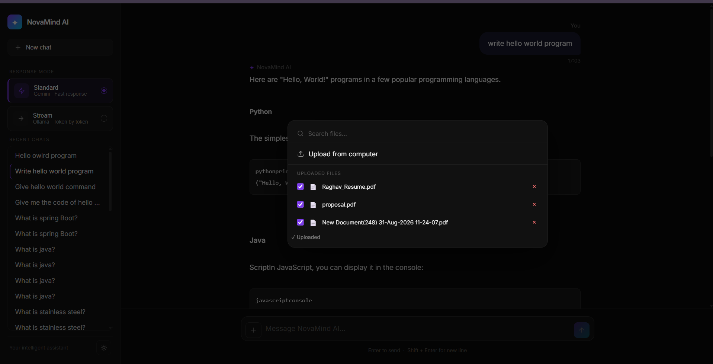

<div align="center">

# 🤖 NovaMind AI

### A production-grade AI Chatbot built with Java & Spring Boot


[Features](#features) · [Tech Stack](#tech-stack) · [Getting Started](#getting-started) · [API](#api-contract) · [Screenshots](#screenshots)

</div>

---

## 📸 Screenshots

### Empty State


### Active Conversation


### Code Response


### PDF Upload Modal


---

## 🧠 What is NovaMind AI?

NovaMind AI is a full-stack AI chatbot built from scratch using Java 21 and Spring Boot 4.1.0. It features intelligent multi-provider routing, a full RAG pipeline for PDF-based Q&A, Redis caching, PostgreSQL conversation storage, and a clean real-time streaming chat UI — all running as a single Spring Boot application.

This project was built step by step as a learning journey through real-world backend engineering — not just a tutorial clone.

---

## ✨ Features

- **Multi-provider AI routing** — Gemini as primary, OpenRouter as secondary, Ollama as local fallback
- **Automatic failover** — if Gemini fails or hits rate limits, OpenRouter takes over automatically
- **Streaming responses** — real-time token-by-token streaming via SSE
- **RAG pipeline** — upload PDFs and ask questions about them with source attribution
- **Conversation memory** — AI remembers context within a session (configurable window)
- **Redis caching** — repeated questions served instantly without hitting the AI (1 hour TTL)
- **PostgreSQL storage** — full conversation history that survives app restarts
- **Chat history sidebar** — browse, load, and rename previous conversations
- **Markdown rendering** — AI responses render with proper headings, bullets, and code blocks
- **Rate limiting** — Bucket4j-based rate limiting to prevent abuse
- **Session isolation** — each user session has its own memory, documents, and history
- **Light and dark theme** — toggle between themes
- **Global error handling** — structured error responses via @RestControllerAdvice
- **GitHub Actions CI** — automated build and test pipeline on every push

---

## 🛠 Tech Stack

| Layer | Technology |
|---|---|
| Language | Java 21 |
| Framework | Spring Boot 4.1.0 |
| AI Layer | Spring AI 2.0.0 |
| Primary AI | Google Gemini (gemini-2.0-flash) |
| Secondary AI | OpenRouter (nvidia/nemotron-3.5-lightning:free) |
| Local AI | Ollama (llama3.2) |
| Embeddings | Ollama (nomic-embed-text) |
| Vector Store | Chroma |
| Cache | Redis |
| Database | PostgreSQL |
| Rate Limiting | Bucket4j |
| Frontend | Vanilla HTML, CSS, JavaScript |
| Containerization | Docker Compose |
| CI | GitHub Actions |

---

## 🏗 Project Structure

src/main/java/project/chatbot/
├── ChatbotApplication.java
├── AppConfig.java
├── RateLimitingFilter.java
├── controller/
│ ├── ChatController.java
│ ├── ChatRequest.java
│ ├── ChatResponse.java
│ ├── DocumentController.java
│ ├── SessionSummary.java
│ └── SaveMessageRequest.java
├── service/
│ ├── ChatService.java
│ ├── ChatResult.java
│ └── RagService.java
├── entity/
│ └── ChatMessageEntity.java
├── repository/
│ ├── ChatMessageRepository.java
│ └── PostgresChatMemoryRepository.java
├── exception/
│ ├── GlobalExceptionHandler.java
│ └── ErrorResponse.java

src/main/resources/
├── application.properties ← gitignored
├── application.properties.example ← copy this
└── static/
└── index.html ← frontend UI


---

## 🚀 Getting Started

### Prerequisites

Make sure the following are running before starting the app:

**1. Ollama**
```bash
ollama serve
ollama pull llama3.2
ollama pull nomic-embed-text
```

**2. Chroma (Docker)**
```bash
docker run -d --name chroma -p 8000:8000 chromadb/chroma
```

**3. Redis (Docker)**
```bash
docker run -d --name chatbot-redis -p 6380:6379 redis:latest
```

**4. PostgreSQL (Docker)**
```bash
docker run -d --name chatbot-postgres -p 5432:5432 \
  -e POSTGRES_DB=chatbotdb \
  -e POSTGRES_USER=chatbot \
  -e POSTGRES_PASSWORD=chatbot123 \
  -e TZ=UTC -e PGTZ=UTC \
  postgres:latest
```

Or use Docker Compose to start all services at once:
```bash
docker-compose up -d
```

### Setup

**1. Clone the repo**
```bash
git clone https://github.com/Raghav-Sharma03/AI-ChatBot-SpringBoot.git
cd AI-ChatBot-SpringBoot
```

**2. Copy the example properties file**
```bash
cp src/main/resources/application.properties.example src/main/resources/application.properties
```

**3. Add your API keys in `application.properties`**
```properties
spring.ai.google.genai.api-key=YOUR_GEMINI_KEY_HERE
spring.ai.openai.api-key=YOUR_OPENROUTER_KEY_HERE
```

- Gemini key → https://aistudio.google.com/apikey (free)
- OpenRouter key → https://openrouter.ai (free, no credit card needed)

**4. Run the app**
```bash
mvn spring-boot:run
```

**5. Open in browser**
http://localhost:8080


---

## 📡 API Contract

### Send a message (standard)
```http
POST /api/chat?sessionId={sessionId}
Content-Type: application/json

{
  "message": "What is Spring Boot?",
  "selectedFiles": []
}
```

### Send a message (streaming)
```http
POST /api/chat/stream?sessionId={sessionId}
Content-Type: application/json

{
  "message": "Explain RAG in detail",
  "selectedFiles": ["document.pdf"]
}
```

### Upload a PDF
```http
POST /api/documents/upload
Content-Type: multipart/form-data

files=<your PDF files>
sessionId=<your session ID>
```

### Delete a document
```http
DELETE /api/documents/{sessionId}/{fileName}
```

### Get chat sessions
```http
GET /api/chat/sessions
```

### Get messages for a session
```http
GET /api/chat/{sessionId}/messages
```

### Delete a session
```http
DELETE /api/chat/{sessionId}
```

### Rename a session
```http
PATCH /api/chat/{sessionId}/rename
Content-Type: application/json

{
  "title": "My new session name"
}
```

### Success Response
```json
{
  "message": "Spring Boot is a Java framework...",
  "sessionId": "session_abc123",
  "requestTime": "2026-10-11T13:00:00",
  "responseTime": "2026-10-11T13:00:02",
  "promptTokens": 65,
  "completionTokens": 20,
  "totalTokens": 85
}
```

### Error Response
```json
{
  "status": 500,
  "error": "Something went wrong",
  "path": "/api/chat",
  "timestamp": "2026-10-11T13:00:00"
}
```

---

## ⚙️ Configuration

| Property | Description | Default |
|---|---|---|
| `chatbot.memory.max-messages` | Max messages in conversation memory | 10 |
| `spring.ai.model.embedding` | Embedding provider | ollama |
| `spring.ai.ollama.embedding.model` | Ollama embedding model | nomic-embed-text |
| `spring.ai.vectorstore.chroma.collection-name` | Chroma collection name | chatbot-docs |
| `spring.data.redis.host` | Redis host | localhost |
| `spring.data.redis.port` | Redis port | 6380 |
| `spring.datasource.url` | PostgreSQL connection URL | jdbc:postgresql://localhost:5432/chatbotdb |

---

## 🧪 Running Tests

```bash
mvn test
```

4 unit tests covering the core service layer.

---

## 📚 What I Learned Building This

- Spring Boot REST API design and best practices
- Spring AI integration with multiple AI providers
- Multi-provider routing and automatic fallback chains
- Conversation memory with MessageWindowChatMemory
- RAG pipeline — PDF ingestion, vector embeddings, similarity search
- Chroma vector database integration via Docker
- Redis caching with configurable TTL
- PostgreSQL integration with Spring Data JPA
- Implementing Spring AI's ChatMemoryRepository for custom persistent storage
- Server-Sent Events (SSE) for real-time streaming responses
- Rate limiting with Bucket4j
- DTO pattern for clean API design
- Global exception handling with @RestControllerAdvice
- Serving a frontend from Spring Boot static resources
- Git branching, PR workflow, and GitHub Actions CI
- Docker Compose for local service orchestration

---

## 👨‍💻 Author

**Raghav Sharma**
- GitHub: [@Raghav-Sharma03](https://github.com/Raghav-Sharma03)

---

## 📄 License

This project is open source.